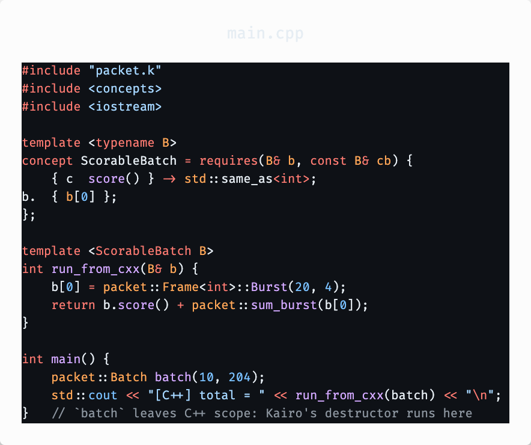
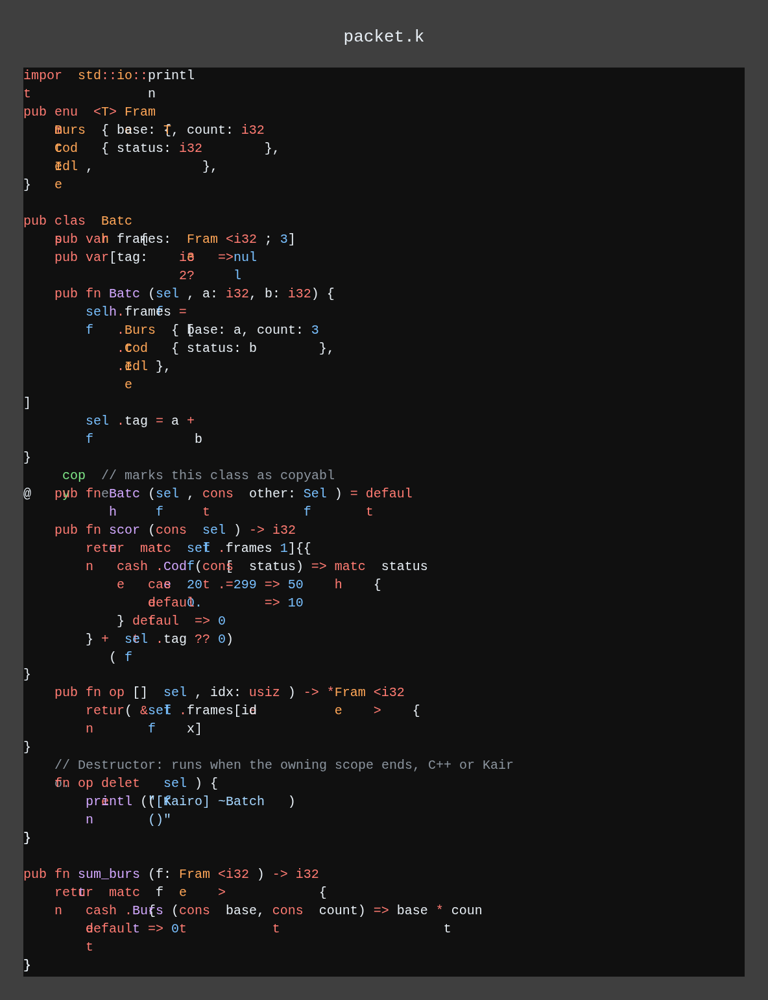
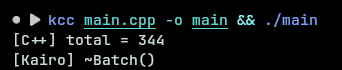
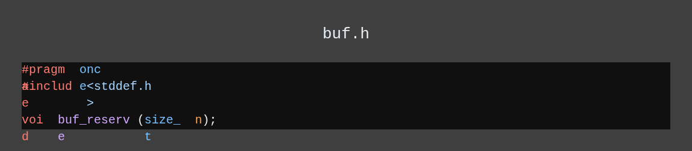
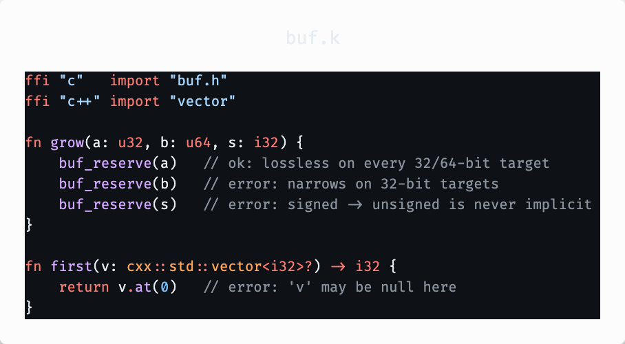
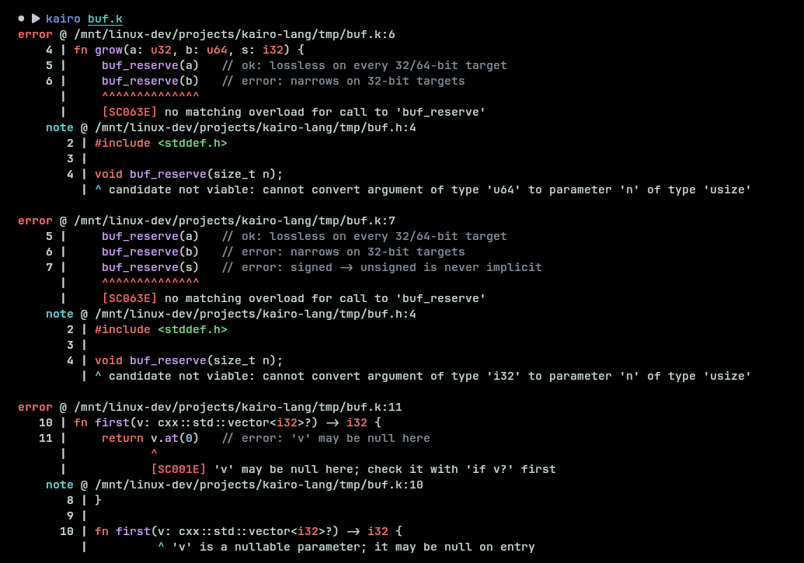

# The Kairo Programming Language

<div align="center">
  
</div>

---

Kairo is a **statically typed compiled general purpose language**, built for systems programming and high-performance applications. Designed with native bi-directional C++ interoperability in mind. Kairo aims to combine the power and control of low-level languages with the safety and clarity of high-level design.

### The goals of Kairo

- Safe, and productive programming language.
- Allow for low-level programming with fine-grained control.
- Native bidirectional C and C++ interoperability.
- Include a portable, well-structured standard library.
- Encourage clear, maintainable, and reviewable code through strong, expressive semantics.
- An alternative to C, C++ or work alongside them.
- No runtime, no garbage collector, no hidden costs - safety through visibility, not restriction.

### Current Status

The **Stage 1 compiler**, written in Kairo, is fully self hosted (November 2026). A release build is bootstrapped by the previous release, and having a seed kairo compiler is a requirement. There's a lit suite of more than 2,000 tests. Releases ship prebuilt for 14 host platforms, and every one of them cross-compiles to 48 targets out of the box: Linux (glibc 2.17 to 2.42, and musl) on up to 19 architectures, Windows, macOS, FreeBSD, NetBSD and WebAssembly.

> [!WARNING]
> The compiler is **not** yet ready for production use *yet*. If you want to help with anything, please reach out to us on [Discord](https://discord.gg/VHCnPccDc) or Github Discussions.

### Why Kairo?

##### Think of programming languages like making coffee

- **C and C++** hands you all the ingredients and equipment, every knob and button live. No recipe, no instructions. You'll have to learn and make something, what you make is on you.
- **Rust** provides you with all the ingredients, fancy equipment, and a precise recipe with every step measured. The coffee comes out reliably good, and the recipe catches mistakes before you brew.
- **Kairo** gives you ingredients, equipment, and recipes, and the kitchen is wired into the C and C++ kitchens next door. Borrow their beans and machines, and send finished coffee back through the same door.

### Design Rationale

- We liked the simplicity of **Python's** syntax but wanted more.
- We wanted the performance and control of **C and C++**.
- We admired **Rust's** safety features but, at times, found them cumbersome.
- We liked **Rust's** Meta-programming and Trait system.
- We liked **Zig's** approach to interoperability.
- We wanted a powerful module system.
- We wanted a robust standard library.
- We wanted a language that would work drop-in with any existing C or C++ codebases.
- We wanted all; So we created **Kairo**.

Kairo is built to slot directly into C **and** C++ ecosystems, offering a fresh syntax and features, without abandoning decades of code.

### Example

This builds today with the Stage 1 compiler. Grab a prebuilt release with the one-line installer, or build from source; see [Getting Started](#getting-started).

C++ includes a `.k` file directly. There is no generated header and no binding layer:

<div align="left">
  
</div>

<details>
<summary>The C++ code to copy into main.cpp</summary>

```cpp
//> main.cpp
#include "packet.k"
#include <concepts>
#include <iostream>

template <typename B>
concept ScorableBatch = requires(B& b, const B& cb) {
    { cb.score() } -> std::same_as<int>;
    { b[0] };
};

template <ScorableBatch B>
int run_from_cxx(B& b) {
    b[0] = packet::Frame<int>::Burst(20, 4);
    return b.score() + packet::sum_burst(b[0]);
}

int main() {
    packet::Batch batch(10, 204);
    std::cout << "[C++] total = " << run_from_cxx(batch) << "\n";
}   // `batch` leaves C++ scope: Kairo's destructor runs here
```

</details>

<div align="left">
  
</div>

<details>
<summary>The Kairo code to copy into main.k</summary>

```kairo
//> packet.k
import std::io::println

pub enum <T> Frame {
    Burst { base: T, count: i32 },
    Code  { status: i32 },
    Idle,
}

pub class Batch {
    pub var frames: [Frame<i32>; 3]
    pub var tag:    i32? = null

    pub fn Batch(self, a: i32, b: i32) {
        self.frames = [
            .Burst { base: a, count: 3 },
            .Code  { status: b },
            .Idle
        ]

        self.tag = a + b
    }

    @copy // marks this class as copyable
    pub fn Batch(self, const other: Self) = default

    pub fn score(const self) -> i32 {
        return match self.frames[1] {
            case .Code(const status) => match status {
                case 200..=299 => 50
                default        => 10
            } default => 0
        } + (self.tag ?? 0)
    }

    pub fn op [] (self, idx: usize) -> *Frame<i32> {
        return &self.frames[idx]
    }

    // Destructor: runs when the owning scope ends, C++ or Kairo.
    fn op finally (self) {
        println("[Kairo] ~Batch()")
    }
}

pub fn sum_burst(f: Frame<i32>) -> i32 {
    return match f {
        case .Burst(const base, const count) => base * count
        default => 0
    }
}
```

</details>

`kcc` is a drop-in replacement for `clang++` that takes Clang's arguments. `kairo` is the Kairo compiler driver.

<div align="left">
  
</div>

### Where Kairo Semantics Differ from C and C++

These are legal C and C++ calls. `clang++` accepts all three. Kairo rejects them:

<div align="left">
  
</div>

<details>
<summary>The C code to copy into buf.c</summary>

```c
//> buf.h
#pragma once
#include <stddef.h>

void buf_reserve(size_t n);
```

</details>

<div align="left">
  
</div>

<details>
<summary>The Kairo code to copy into buf.k</summary>

```kairo
//> buf.k
ffi "c"   import "buf.h"
ffi "c++" import "vector"

fn grow(a: u32, b: u64, s: i32) {
    buf_reserve(a)   // ok: lossless on every 32/64-bit target
    buf_reserve(b)   // error: narrows on 32-bit targets
    buf_reserve(s)   // error: signed -> unsigned is never implicit
}

fn first(v: cxx::std::vector<i32>?) -> i32 {
    return v.at(0)   // error: 'v' may be null here
}
```

</details>

<div align="left">
  
</div>

### Kairo's UB Surface vs C++

This is where each one stands as of 0.3.0. "C++" is the ISO C++ behaviour; "Kairo" is what Kairo code gets, without modifying any C++ it interops with.

**Defined or rejected in Kairo**

Overhead is the extra instructions on the path that runs, against the same code compiled as C++ by Clang (x86-64, `-O2`); a failure branch is out of line and runs only when the check fails. "None" means the same instructions as C++, within one. A rejected construct costs nothing at run time.

| Undefined in C++ | In Kairo | Overhead (In Instruction count on `x86_64-linux-any`) compared to C++ |
|---|---|---|
| Signed integer overflow (`+`, `-`, `*`, unary `-`) | Two's complement wrapping | None |
| Shift by a count >= the width, or negative | For run-time it's masked to the width; Constant is rejected (compile error `[SC262E]`) | None |
| Integer `/ 0` and `% 0` | Terminates: `division by zero` | +2 per division |
| `MIN / -1`, `MIN % -1` | Defined: `MIN` and `0` | +1 per signed division |
| Float to integer out of range, NaN, infinity | Saturates; NaN gives 0 | +7 |
| Narrowing integer cast | Defined, modulo 2^N | None |
| Enum cast to a value that has no variant | Run time checked; Constant is rejected (compile error `[SC252E]`). `@open` enums take every value of their type | +2 |
| Reading an uninitialised variable, field, array or heap object | Everything is default/zero-initialised | None |
| No return on a non-`void` | Rejected (compile error `[SC104E]`) | None |
| Unsequenced or unspecified evaluation order (`f(g(), h())`, `f(i++, i++)`, `a[i] = g(i)`) | Defined, left to right | None |
| Out-of-bounds index on a vector, slice, string, map or fixed array | Traps `index I is out of bounds for length N`. A constant out-of-range index into a fixed array is rejected (compile error `[SC291E]`) | +2 to +3 per index; none where the index is proven in range |
| Safe-pointer offset past its array (constant offset) | Rejected (compile error `[SC363E]`) | None |
| Subtracting two safe pointers | Rejected (compile error `[SC067E]`) | None |
| Use after move, including a moved field or element, a branch and a loop | Rejected (compile error `[SC052E]`) | None |
| Moving a value out through a pointer or reference | Rejected (compile error `[SC182E]`) | None |
| Deleting through a base with no virtual destructor | Rejected (compile error `[SC056E]`) | None |
| Calling a pure virtual from a constructor or destructor | Rejected (compile error `[C170E]`) | None |
| Failed downcast | `as *D` terminates; `as *D?` gives `null` | +2 for `as *D`; None for `as *D?` |
| Writing to a `const` object | Rejected (compile error `[SC071E]`) | None |
| Calling through the wrong function type | Rejected (compile error `[SC027E]`) | None |
| Type punning through pointers to differently typed integers or floats | Defined: an `unsafe *` to an integer wider than a byte, or a float, may alias any object | None |
| Two references to the same object passed as two `@inout` arguments | Defined: no `restrict` is assumed | None |
| A side-effect-free loop that never ends | Runs forever: no forward-progress assumption | None |
| A pointer to a temporary used after its full expression | Rejected (compile error `[SC069E]`) | None |
| The optimiser deleting a null check after a dereference | Null checks are always kept | None |
| A C++ exception escaping into Kairo code | Defined: terminates at the Kairo frame (unless `@unwind` is given) | None |

**In progress**

| Undefined in C++ | Kairo today | Where it is going |
|---|---|---|
| Dangling references: returning the address of a local, a slice of a local vector, a pointer held across a reallocating `push`, a closure or generator outliving what it captures | Compiles | Rejected by Tether, Kairo's lifetime checker |
| Use after `@destroy`, double `@destroy`, `@destroy` of a local or interior pointer | Not checked | Tether |
| Safe-pointer arithmetic with a run-time offset; `<` between pointers into different arrays | Not checked | Tether |
| Null reaching a safe `*T` from C++ or from a cast | Not checked | Tether |
| Moves are destructive by definition, but the moved-from object's destructor still runs in the generated code | `@relocatable` types move by `memcpy` with no destructor call; a `@move` constructor that leaves its source live is warned about | Destructive moves |
| Static initialisation order across modules | Unspecified | Defined order |
| `@destroy` through a plain base declared in another module | Checked only when the derived class is in the same module | Checked across modules |

**Not planned for the near future**

| Undefined in C++ | In Kairo |
|---|---|
| Out-of-bounds access through `unsafe *T` arithmetic | Undefined (requires `unsafe {}`) |
| Writing through an `unsafe` cast that removes `const`, including string literal bytes | Undefined |
| Misaligned access through `unsafe *T` | Undefined |
| A `bool` holding a value other than 0 or 1 (from union or `unsafe` bytes) | Undefined |
| Reading a union member other than the last one written | The bytes are reinterpreted |
| Float `/ 0.0` | IEEE 754 |
| Unbounded recursion | Stack overflow crashes the program |
| Reaching `@assume(false)` or `__builtin_unreachable()` | asserts at O0, and without `unsafe` it warns at `-O1` and above as the check is removed |
| Recursive initialisation of a function-local `static` | Aborts |
| Code inside imported C and C++ headers | Keeps C and C++ rules (for example, signed overflow in a header is still undefined) |

### Getting Started

**Download a release:** `curl -fsSL https://www.kairolang.org/install.sh | sh` (Linux, macOS, BSD) or `irm https://www.kairolang.org/install.ps1 | iex` (Windows PowerShell), or grab an acrhive from the [releases page](https://github.com/kairolang/kairo/releases).

**Build from source:** see [BUILD.md](BUILD.md) - covers the quick install script, manual setup, PATH configuration, the VSCode extension, and debugging.

**Code reference:** the [Compiler directory](https://github.com/kairolang/kairo/tree/main/Compiler) is the Stage 1 compiler, written in Kairo. [Compiler/README.txt](Compiler/README.txt), and [Compiler/Spec](Compiler/Spec) holds the compiler's design specs.

### License

Kairo is licensed under the [Apache License 2.0 with the Kairo Runtime Library Exception](LICENSE)

The design documents under [Compiler/Spec/](Compiler/Spec/) are licensed under [CC BY 4.0](Compiler/Spec/LICENSE).

### AI Usage Disclosure

[Read The Full Post Here](https://www.kairolang.org/blog/how-ai-is-used-in-kairo/). TLDR: Lang design, Compiler, and Architecture are 100% human. No AI was used for the core logic or passes in the compiler and language design. Docs have AI usage; mostly used for polishing.

### Acknowledgements

We want to thank all our contributors pushing Kairo forward.
<!-- @jrcarl624 I helped found the language and worked on some of the key syntax choices, such as derive and Rust like elements. Check out the old branches to see my work -->
<a href="https://star-history.dera.page/#kairolang/kairo&type=date&legend=top-left">
 <picture>
   <source media="(prefers-color-scheme: dark)" srcset="https://star-history.dera.page/svg?repos=kairolang/kairo&type=date&theme=dark&legend=top-left" />
   <source media="(prefers-color-scheme: light)" srcset="https://star-history.dera.page/svg?repos=kairolang/kairo&type=date&legend=top-left" />
   
 </picture>
</a>
