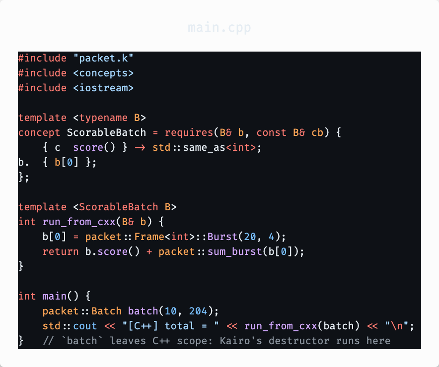
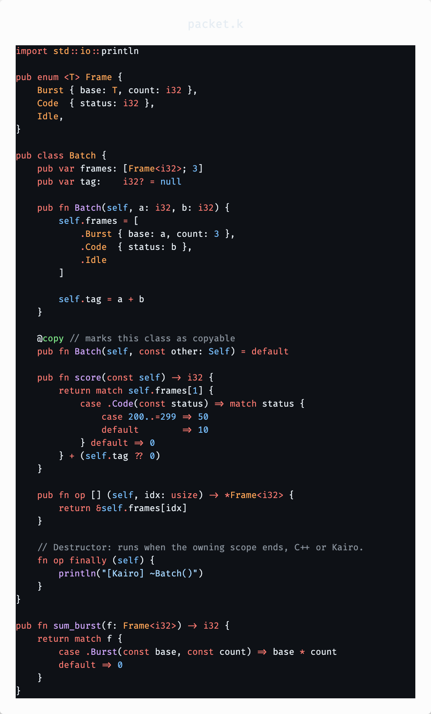
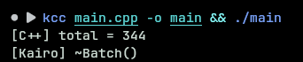
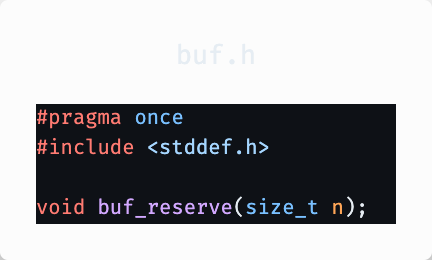
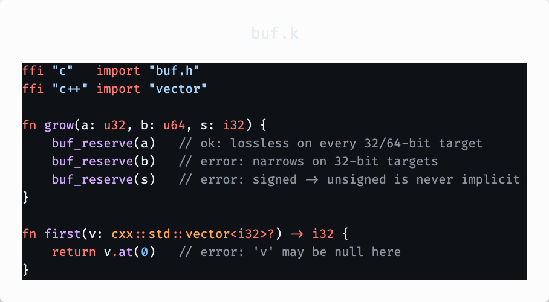
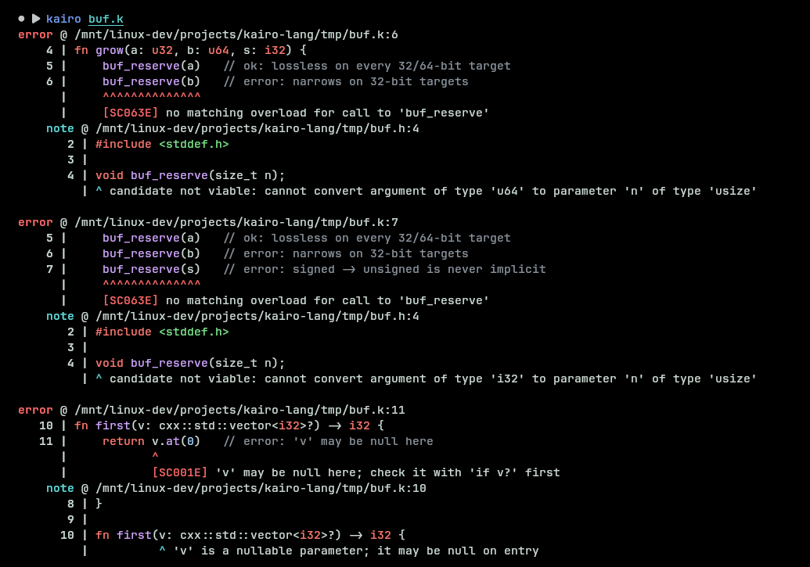

# The Kairo Programming Language

<div align="center">
  
</div>

---

Kairo is a **statically typed compiled general purpose language**, built for systems programming and high-performance applications. Designed with native bi-directional C++ interoperability in mind. Kairo aims to combine the power and control of low-level languages with the safety and clarity of high-level design.

### The goals of Kairo

- Safe, and productive programming language.
- Allow for low-level programming with fine-grained control.
- Native bidirectional C and C++ interoperability.
- Include a portable, well-structured standard library.
- Encourage clear, maintainable, and reviewable code through strong, expressive semantics.
- An alternative to C, C++ or work alongside them.
- No runtime, no garbage collector, no hidden costs - safety through visibility, not restriction.

### Current Status

The **Stage 1 compiler**, written in Kairo, is fully self hosted (November 2026). A release build is bootstrapped by the previous release, and having a seed kairo compiler is a strict requirement. there's a lit suite of about 2,000 tests and builds for 14 targets.

> [!WARNING] The [documentation](https://www.kairolang.org/docs) covers the language as Stage 1 implements it, and the [status page](https://www.kairolang.org/docs/status/) lists what is not built yet. The compiler is not ready for production use. If you want to help with documentation, please reach out to us on [Discord](https://discord.gg/VHCnPccDc)

### Why Kairo?

##### Think of programming languages like making coffee

- **C and C++** hands you all the ingredients and equipment, every knob and button live. No recipe, no instructions. You'll have to learn and make something, what you make is on you.
- **Rust** provides you with all the ingredients, fancy equipment, and a precise recipe with every step measured. The coffee comes out reliably good, and the recipe catches mistakes before you brew.
- **Kairo** gives you ingredients, equipment, and recipes, and the kitchen is wired into the C and C++ kitchens next door. Borrow their beans and machines, and send finished coffee back through the same door.

### Design Rationale

- We liked the simplicity of **Python's** syntax but wanted more.
- We wanted the performance and control of **C and C++**.
- We admired **Rust's** safety features but, at times, found them cumbersome.
- We liked **Rust's** Meta-programming and Trait system.
- We liked **Zig's** approach to interoperability.
- We wanted a powerful module system.
- We wanted a robust standard library.
- We wanted a language that would work drop-in with any existing C or C++ codebases.
- We wanted all; So we created **Kairo**.

Kairo is built to slot directly into C **and** C++ ecosystems, offering a fresh syntax and features, without abandoning decades of code.

### Example

This builds today with the Stage 1 compiler (build from source for now; see [Getting Started](#getting-started)).

C++ includes a `.k` file directly. There is no generated header and no binding layer:

<div align="left">
  
</div>

<details>
<summary>The C++ code to copy into main.cpp</summary>

```cpp
//> main.cpp
#include "packet.k"
#include <concepts>
#include <iostream>

template <typename B>
concept ScorableBatch = requires(B& b, const B& cb) {
    { cb.score() } -> std::same_as<int>;
    { b[0] };
};

template <ScorableBatch B>
int run_from_cxx(B& b) {
    b[0] = packet::Frame<int>::Burst(20, 4);
    return b.score() + packet::sum_burst(b[0]);
}

int main() {
    packet::Batch batch(10, 204);
    std::cout << "[C++] total = " << run_from_cxx(batch) << "\n";
}   // `batch` leaves C++ scope: Kairo's destructor runs here
```

</details>

<div align="left">
  
</div>

<details>
<summary>The Kairo code to copy into main.k</summary>

```kairo
//> packet.k
import std::io::println

pub enum <T> Frame {
    Burst { base: T, count: i32 },
    Code  { status: i32 },
    Idle,
}

pub class Batch {
    pub var frames: [Frame<i32>; 3]
    pub var tag:    i32? = null

    pub fn Batch(self, a: i32, b: i32) {
        self.frames = [
            .Burst { base: a, count: 3 },
            .Code  { status: b },
            .Idle
        ]

        self.tag = a + b
    }

    @copy // marks this class as copyable
    pub fn Batch(self, const other: Self) = default

    pub fn score(const self) -> i32 {
        return match self.frames[1] {
            case .Code(const status) => match status {
                case 200..=299 => 50
                default        => 10
            } default => 0
        } + (self.tag ?? 0)
    }

    pub fn op [] (self, idx: usize) -> *Frame<i32> {
        return &self.frames[idx]
    }

    // Destructor: runs when the owning scope ends, C++ or Kairo.
    fn op finally (self) {
        println("[Kairo] ~Batch()")
    }
}

pub fn sum_burst(f: Frame<i32>) -> i32 {
    return match f {
        case .Burst(const base, const count) => base * count
        default => 0
    }
}
```

</details>

`kcc` is a drop-in replacement for `clang++` that takes Clang's arguments. `kairo` is the Kairo compiler driver.

<div align="left">
  
</div>

### Where Kairo Semantics Differ from C and C++

These are legal C and C++ calls. `clang++` accepts all three. Kairo rejects them:

<div align="left">
  
</div>

<details>
<summary>The C code to copy into buf.c</summary>

```c
//> buf.h
#pragma once
#include <stddef.h>

void buf_reserve(size_t n);
```

</details>

<div align="left">
  
</div>

<details>
<summary>The Kairo code to copy into buf.k</summary>

```kairo
//> buf.k
ffi "c"   import "buf.h"
ffi "c++" import "vector"

fn grow(a: u32, b: u64, s: i32) {
    buf_reserve(a)   // ok: lossless on every 32/64-bit target
    buf_reserve(b)   // error: narrows on 32-bit targets
    buf_reserve(s)   // error: signed -> unsigned is never implicit
}

fn first(v: cxx::std::vector<i32>?) -> i32 {
    return v.at(0)   // error: 'v' may be null here
}
```

</details>

<div align="left">
  
</div>

### Getting Started

**Download a release:** grab a prebuilt binary from the [releases page](https://github.com/kairolang/kairo/releases).

**Build from source:** see [BUILD.md](BUILD.md) - covers the quick install script, manual setup, PATH configuration, the VSCode extension, and debugging.

**Code reference:** the [Compiler directory](https://github.com/kairolang/kairo/tree/main/Compiler) is the Stage 1 compiler, written in Kairo. [Compiler/README.txt](Compiler/README.txt), and [Compiler/Spec](Compiler/Spec) holds the compiler's design specs.

### License

Kairo is licensed under the [Apache License 2.0 with the Kairo Runtime Library Exception](LICENSE)

The design documents under [Compiler/Spec/](Compiler/Spec/) are licensed under [CC BY 4.0](Compiler/Spec/LICENSE).

### AI Usage Disclosure

[Read The Full Post Here](https://www.kairolang.org/blog/how-ai-is-used-in-kairo/). TLDR: Lang design, Compiler, and Architecture are 100% human. No AI was used for the core logic or passes in the compiler and language design. Docs have AI usage; mostly used for polishing.

### Acknowledgements

We want to thank all our contributors pushing Kairo forward.
<!-- @jrcarl624 I helped found the language and worked on some of the key syntax choices, such as derive and Rust like elements. Check out the old branches to see my work -->
<a href="https://star-history.dera.page/#kairolang/kairo&type=date&legend=top-left">
 <picture>
   <source media="(prefers-color-scheme: dark)" srcset="https://star-history.dera.page/svg?repos=kairolang/kairo&type=date&theme=dark&legend=top-left" />
   <source media="(prefers-color-scheme: light)" srcset="https://star-history.dera.page/svg?repos=kairolang/kairo&type=date&legend=top-left" />
   
 </picture>
</a>
